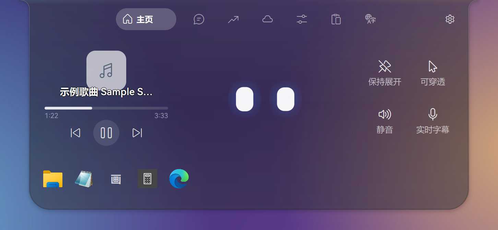
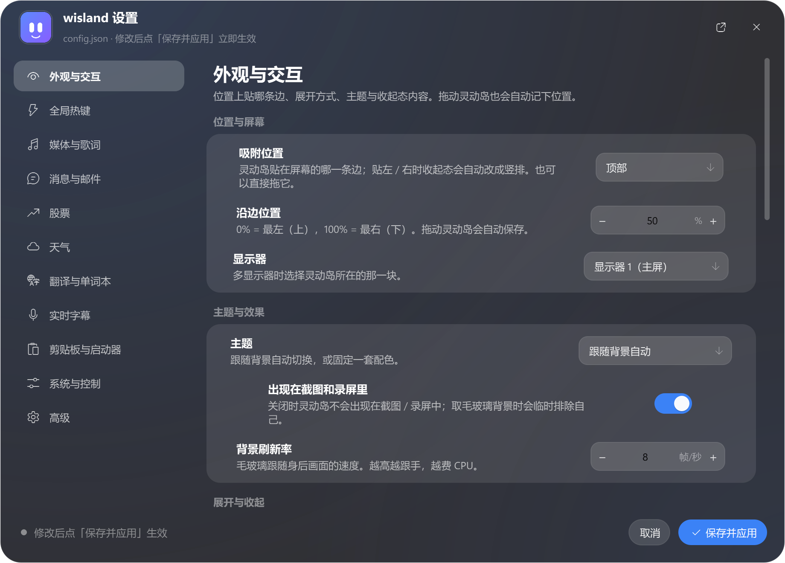
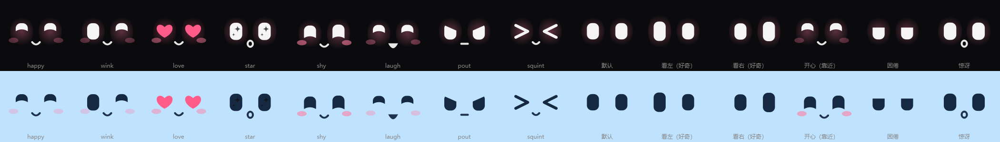
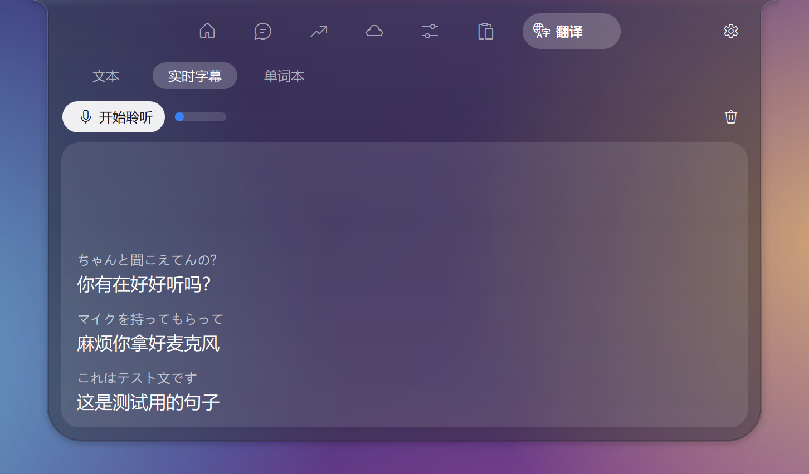
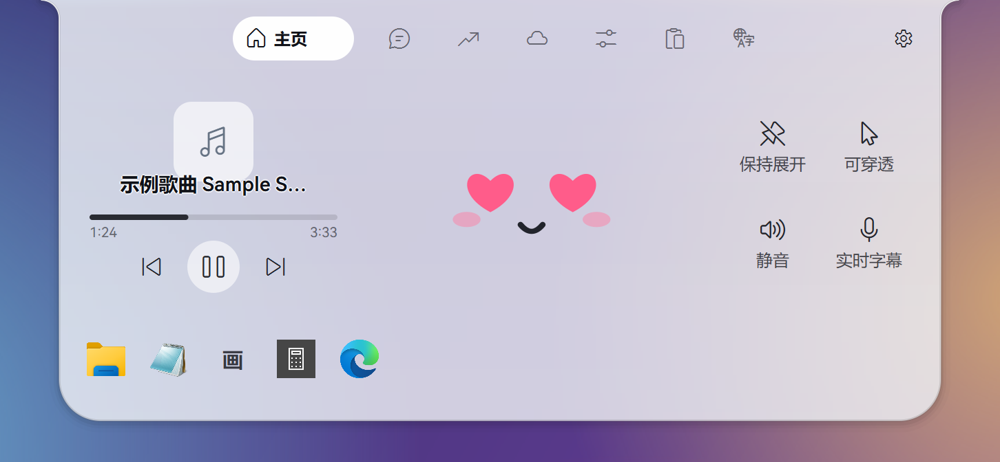
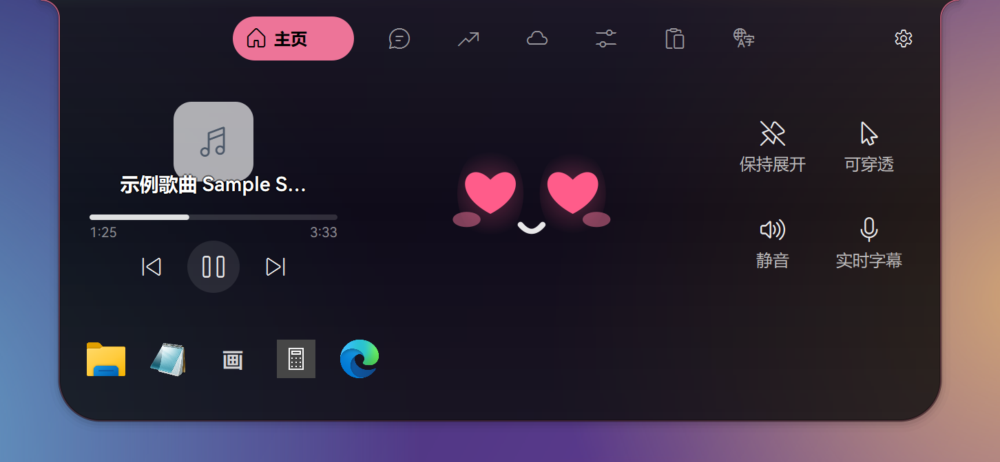
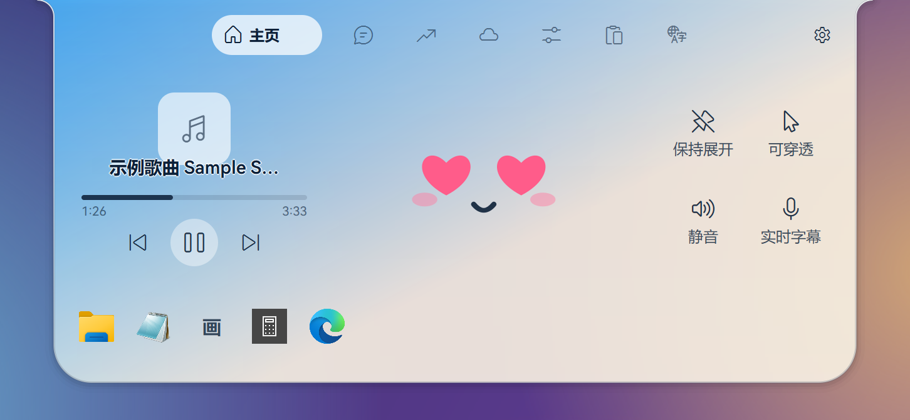

# Wisland · Windows 液态灵动岛

贴在屏幕边缘的液态毛玻璃胶囊，悬停弹性展开。Windows 10 / 11，Python + PySide6。

## 安装

1. 安装 **Python 3.10 或更新版本**：<https://www.python.org/downloads/windows/>
   （安装时勾选 **Add python.exe to PATH**）
2. 下载本项目：右侧 **Releases** 里下载 `wisland-x.y.z.zip` 并解压
   （或 `git clone https://github.com/AsamiAkito/wisland.git`）。
   路径里最好不要有特殊字符。
3. 双击 **`setup.bat`**：自动创建 `.venv`、补齐 pip、安装依赖（PyPI 连不上时自动改用清华镜像），需要几分钟。
4. 双击 **`wisland.vbs`** 启动。还没运行过 `setup.bat` 时，它会提示并帮你运行。

开机自启：右键灵动岛 → 开机自启。

## 功能

- **液态外形**：与屏幕边缘以表面张力相连；按住拖动会拉丝、断开，松手吸附到最近的边缘；**贴左 / 右时收起态自动改成细长竖排**（时间、天气、音乐、字幕上下排列，文字保持正向，宽度只比上下吸附的胶囊略粗）
- **收起态**：时间天气 / 小形象 / 正在播放，滚轮切换；有未读消息时，时间天气中间显示全部有新消息的来源图标，小形象、歌词和字幕里也显示来源图标（贴左 / 右的竖排为单列竖排）；开始播放音乐时自动显示**滚动歌词**（加宽显示完整一句，右侧可直接播放 / 暂停）；实时字幕时上日语、下中文两行显示；新消息、音量、股票提醒以动画浮现
- **小形象**：发光双眼，跟随鼠标，靠近时随机变换表情；按压会被挤歪
- **音乐**：网易云音乐（直接读取本地播放日志，无需插件）、QQ 音乐、Spotify、B 站 / 浏览器等；歌词默认优先网易云公开接口，匹配不到自动回退到 LRCLIB 等免费源，也可以在设置里调整歌词源顺序 / 填自定义 API
- **主页**：播放控制、展开方式、可穿透、静音、实时字幕、应用启动器（默认文件资源管理器；点 + 可添加任意文件 / exe，右键重命名或移除）
- **消息**：QQ / 微信 / 邮件 / 飞书 / 钉钉 提醒（消息页与灵动岛提醒里显示各自的真实应用图标；新消息时吸附边亮起 5 秒呼吸灯，浅蓝 / 浅青 / 浅橙 / 浅紫 / 浅黄分别对应 QQ / 微信 / 邮件 / 飞书 / 钉钉；点击磁贴优先打开最近一条消息的来源应用；「设置 → 消息与邮件 → 打开应用」每次启动 wisland 都会自动读取仍为空的本地程序路径，之后可自行修改；读取 Windows 通知、任务栏闪烁，以及飞书 / 钉钉右下角的通知浮窗；消息页点 + 添加模块，右键磁贴可移除；飞书 / 钉钉会尽量读取浮窗里的发送人与正文；右键历史区域可清空消息）
- **DeepSeek 桌面版**：读取 DSH 的会话日志（`%USERPROFILE%\.dsh\sessions`，只读），每轮回答结束 / 生成失败 / 输出被截断时在岛上提醒，正文是回答开头的一段；在 **设置 → 消息与邮件 → DeepSeek 桌面版** 里可关闭、只看主会话，或让 DSH 窗口在前台时不提醒。它不会修改 dsh-pet 或任何其它应用的设置——如果同时装了 dsh-pet 并开着系统通知，两边会各提醒一次。
- **桌面弹窗**：可开关，大小可调（70%–160%，100% 为当前默认尺寸）；在中心底部 / 中心顶部 / 左下 / 右下 / 左上 / 右上显示圆角消息提示框（跟随当前深色 / 浅色 / 胭脂 / 晴空主题），淡入淡出，每条独立显示 3 秒；第一条固定在贴边位置，后来的向内侧排，到期时朝屏幕边缘上移 / 下移、缩小并渐隐，后一条补位
- **股票**：A 股 / 港股 / 美股行情与分时（腾讯财经公开接口），点 + 搜索添加，右键删除；右键菜单 → 显示板块 可关闭 / 开启（关闭后不再轮询行情）
- **天气**：默认城市自动跟随公网 IP 所在城市（右键城市胶囊可绑定固定主城市 / 取消绑定）；绑定后仍会显示当前 IP 城市的天气，自己添加的城市不受影响；逐小时与 5 天预报（默认 Open-Meteo，无需 Key）
- **控制**：音量、亮度、WLAN、蓝牙；检测到 Clash Verge 时显示代理控制与订阅流量
- **剪贴板**：最近 10 条文字 / 图片，点击复制
- **翻译**：日译中；实时字幕（系统声音 → 日语识别 → 翻译），滚轮上翻查看历史，点词查词，加入单词本并同步到 Anki
- **主题与字体**：深色 / 浅色 / 胭脂撞色 / 晴空渐变；字体可以在 **设置 → 外观与交互 → 字体** 里从本机字体库挑选（支持搜索、只看中文字体、实时预览），选「默认字体」恢复内置字体栈（HarmonyOS Sans → MiSans → 微软雅黑 UI）。
- **关于与自动更新**：**设置 → 关于** 显示版本、作者与开源信息；源码运行时可以从 CNB 拉取最新源码压缩包，自动备份并替换程序文件（保留配置与数据），更新后一键重启。打包版也能自更新：下载 CNB Release 压缩包，退出后自动替换 exe 与 _internal，保留 config.json、data、models；旧版本只保留最近一份备份，替换失败会自动回滚，若新版本启动失败可用备份手动回滚；源码运行仍走源码更新。

操作：悬停展开（停在上次看的页面），鼠标离开收起；**双击**灵动岛切换「长关」（不再自动展开）；右键打开菜单（设置…、主题、展开方式、显示板块、可穿透、打开 config.json 等）。默认开启「保持置顶」，可在 **设置… → 外观与交互** 关闭；关闭后灵动岛可以被其他窗口盖住。

所有配置都可以在**右键 → 设置…** 里可视化填写，不用手改 JSON。

## 可选设置

配置文件是 `config.json`（首次启动自动生成）。右键灵动岛 → **设置…** 打开可视化设置窗口：
左侧按功能分类（外观、热键、媒体、消息、股票、天气、翻译、字幕、启动器、系统、高级、关于），
右侧是表单；点「保存并应用」立即生效。高级页可以导入 / 导出配置、恢复默认，也可以打开原始 `config.json`。

也可以右键 → 打开 config.json 直接编辑，改完后右键 → 重新加载配置。下表的功能都能在设置窗口里填。

| 功能 | 需要什么 |
| --- | --- |
| 自定义界面字体 | 设置 → 外观与交互 → 字体：直接读取 Windows 已安装的字体，不用手改配置 |
| 翻译、实时字幕的中文翻译 | DeepSeek API Key → `translate.api_key` |
| 实时字幕的日语识别 | 首次点「开始聆听」会在应用内下载模型（约 630 MB），按钮旁显示进度，可取消 / 断点续传；Hugging Face 连不上会自动切到 hf-mirror，无需手动运行脚本 |
| 点词查词的词典 | `.venv\Scripts\python.exe scripts\download_models.py --dict` |
| 天气用 OpenWeather | `weather.api_key`（留空则使用 Open-Meteo） |
| 天气默认城市 | 自动跟随公网 IP；在天气页右键城市胶囊可绑定 / 取消绑定，绑定后仍会显示当前 IP 城市（`weather.pinned_city`） |
| 自选股 | 股票页点 **+** 搜索添加，或编辑 `stocks.watchlist` |
| 邮件未读提醒（不开 Thunderbird） | `mail.imap` 里填 IMAP 授权码 |
| Windows「邮件」/ 新版 Outlook 提醒 | 无需配置：自动读取系统通知与任务栏闪烁（需在系统设置里允许该应用通知） |
| 飞书 / 钉钉提醒 | 消息页点 + 添加模块；无需账号密码（读系统通知 / 任务栏闪烁 / 右下角通知浮窗） |
| 飞书 / 钉钉正文预览 | 默认自动读取通知浮窗里的发送人与正文；`notify.body_preview` 控制哪些模块显示正文。若应用设置里启用了 Windows 系统通知，也会从 toast 读取 |
| DeepSeek 桌面版提醒 | 无需配置：自动读取 `%USERPROFILE%\.dsh\sessions`；在 设置 → 消息与邮件 里启用「DeepSeek」模块（或消息页点 + 添加）。只读日志，不需要 API Key |
| 同步到 Anki | 安装 Anki 插件 AnkiConnect |

## 常见问题

- **双击 vbs 报错 80070002 / 没反应**：还没安装运行环境，先运行 `setup.bat`。日志在 `data\wisland.log`。
- **setup.bat 提示找不到 Python**：装 Python 时没勾选 Add to PATH；重新运行安装程序选 Modify 勾上即可。
- **没显示正在播放 / 没有歌词**：网易云无需设置（读取它的本地日志）；QQ 音乐需在 设置 → 常规设置 中勾选「显示系统媒体传输控制(SMTC)」。没有接入系统媒体控件的播放器，播放按钮会改发键盘媒体键。网易云没有版权的歌曲会继续尝试 LRCLIB / 自定义源；也可以到 设置 → 媒体与歌词 → 歌词源 调整回退顺序。
- **不想自动切到音乐 / 不要歌词**：右键 → 设置… → 媒体与歌词 里关掉自动切换 / 歌词（或 `config.json → media.auto_show` / `media.lyrics`）。
- **不想在灵动岛里看到某些板块**：右键 → 设置… → 外观与交互 → 显示的板块 里取消勾选（股票 / 天气 / 控制 / 剪贴板 / 翻译），
  或右键 → 显示板块，或编辑 `config.json → island.hidden_tabs`（如 `["weather", "clip"]`）。关闭的板块会从标签栏移除；
  股票还会停止行情轮询与涨跌提醒。再勾选一次即可恢复，主页与消息固定显示。
- **没收到 Windows「邮件」/ Outlook 的提醒**：先在 系统设置 → 通知 里允许该应用通知；wisland 只读系统通知库和任务栏闪烁，不需要邮箱密码。
- **消息页没有飞书 / 钉钉**：点消息页右上角 **+** 添加；飞书 / 钉钉不依赖 Windows 系统通知（会识别右下角的通知浮窗）。如果添加后仍收不到，确认飞书 / 钉钉正在运行，且没有把通知浮窗关掉。
- **清空消息**：在消息页右键历史 / 空白区域 →「清空全部消息」；右键某个模块磁贴可只清空该模块的消息。「全部已读」只清未读计数。
- **飞书 / 钉钉只显示「新消息」没有正文**：通知浮窗里的文字要通过 UI Automation 读取，极少数版本 / 关闭辅助功能时会读不到，只能提醒「新消息」；在应用设置里启用 Windows 系统通知后，`notify.body_preview` 里的模块也会显示 toast 正文预览。
- **DeepSeek 桌面版提醒和 dsh-pet 重复**：wisland 不会修改 dsh-pet 或任何其它应用的设置；如果同时装了 dsh-pet 并开着系统通知，两边会各提醒一次。想减少提醒可以自行在对应应用里关掉其中一个。
- **蓝牙磁贴是灰色**：电脑没有蓝牙适配器或驱动不支持系统开关，点击会打开系统蓝牙设置。
- **添加城市失败 / 天气一直显示「请求超时」**：wisland 会自动重试、在直连失败时改走 Windows 系统代理，并依次尝试多个地理编码源（Open-Meteo / Photon / Nominatim）；整批失败后 60 秒再试。仍失败就检查网络 / 代理能否访问 `api.open-meteo.com`、`geocoding-api.open-meteo.com`（或在 设置… → 天气 里填 OpenWeather API Key 改用 OpenWeather）。添加城市时也可以直接输入「纬度,经度」跳过联网查询。
- **天气默认城市不是本地**：默认城市按公网 IP 判断（开代理 / TUN 时通常是代理出口城市）。在天气页右键默认城市 →「绑定主城市」可固定；绑定后当前 IP 城市仍会作为第二项显示，右键它 →「取消绑定」恢复跟随 IP。自己添加的城市不受影响。
- **热键无效**：可能被其他软件占用，右键 → 设置… → 全局热键 换一个组合（或改 `config.json → hotkeys`）。

## 效果图

&nbsp;
&nbsp;

 右键 → 设置…：所有配置都能可视化修改，保存后立即生效

---

实时字幕与单词本流水线移植自 [YishengTranslator-White](https://github.com/kayson-39/YishengTranslator-White)（MIT）。MIT License.
